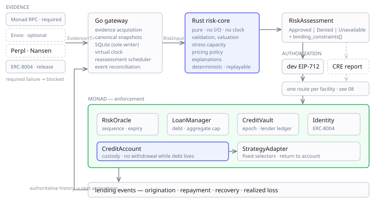

# 01 · Architecture



## The seam

One boundary carries the load:

```text
RiskInput ──► [ pure fn, no I/O, pinned model ] ──► RiskAssessment
```

Evidence integrations produce fields in `RiskInput`; authorization and execution integrations consume assessments and generate lending events. **Optional enrichment can be omitted; required evidence and enforcement dependencies cannot.** Required evidence failure produces `Unavailable` and blocks risk-increasing authorization. Optional evidence is omitted with its absence recorded and no clean-history benefit.

An acquisition failure never changes evidence origin from observed to synthetic. The scenario baseline uses separately bound test deployments and retained fixtures; switching to it is an explicit environment change. The release still requires the selected chain and the registry acceptance described in [08 · Integrations](08-integrations.md).

## Dependency order

```text
Versioned evidence + policy + explicit time
                    ↓
              Rust risk-core
                    ↓
             RiskAssessment
                    ↓
          eligible + authorized?
                    ↓
       LoanManager + CreditAccount
                    ↓
  execution · repayment · recovery · realized loss
                    ↓
        authoritative lending events
                    ↓
             next assessment
```

Provider APIs enrich evidence. CRE can validate and deliver an assessment. Kuru can expose a market signal. **None replaces the contract's independent accounting and execution checks.**

## Ownership

| Component | Owns | Does not own |
|---|---|---|
| Rust `risk-core` | Validation, valuation, eligibility, limits, pricing, stress, explanations | Network, signing, persistence, wall-clock |
| Rust `risk-service` | Service boundary, schema validation, resource limits; HTTP baseline, gated gRPC transport | Database state, provider orchestration |
| Go `gateway` | Evidence acquisition, canonical snapshots, SQLite, contract events, product API, replay, **reassessment scheduling** | Discretionary changes to engine output |
| Go `simulator` | Virtual clock, ordered events, independent outcome generation | Pretending virtual age is onchain age |
| Agent runner | Observe, propose, commit forecast, request or decline, execute, repay | Risk approvals, arbitrary custody access |
| Solidity | Facility state, balances, debt, allowed operations, authorization, loss allocation | Estimating real-world default probability |
| Frontend | Comparison, lifecycle actions, evidence drilldown, lender outcomes | Manufacturing history, silently changing modes |

**Go's substantive job is the simulation clock** — compressing months of
agent history into weeks — plus provider fan-out and the reassessment
scheduler. **Rust's purity is a scheduling advantage**: golden-fixture
testable offline while contracts are still moving.

> **Corrected 14 September.** As built, Go's substantive job turned out to
> be the *data plane* — evidence acquisition, canonical snapshots, the
> assessment API and the reassessment scheduler — with the simulation
> clock one package inside it (`gateway/sim`). The sentence above ranked
> them the other way round, and a reader taking it at face value would
> look for the project's weight in the wrong place.

## Stack

This is the stack as **planned**. The right-hand column records what is
actually in the tree on 14 September, because a stack table that lists
dependencies the repository does not have is a reader's first wrong turn.

| Layer | Planned | As built, 14 Sep |
|---|---|---|
| Chain | Monad | Monad testnet, chain 10143 |
| Contracts | Solidity + Foundry, OpenZeppelin (pin after first green build) | Solidity + Foundry. **No OpenZeppelin** — `forge-std` is the only submodule; the contracts implement their own access control and reentrancy discipline, which `docs/05` specifies and tests |
| Risk engine | Rust, `rust_decimal` or integer base units | Rust, **integer base units only**. No `rust_decimal`: the engine must hash byte-identically against Go and Solidity, and a decimal type with its own rounding would break that |
| Data plane | Go, SQLite/WAL | As planned |
| Internal transport | HTTP/JSON baseline; isolated protobuf/gRPC gate on 6 Oct | **HTTP/JSON only.** The gRPC gate is not built; it sits after the freeze by design |
| Indexer | Envio | **Built** (`indexer/`). HyperIndex over HyperSync on 10143, RPC on anvil. It reconstructs the loan lifecycle from the event log, which is a different question from the one the gateway answers: the gateway reads loan **structs** over `eth_call` — current state — and a struct cannot say when recovery opened or what was collected on the way. An earlier version of this row said the gateway "follows contract events directly". It does not; it reads state. |
| Frontend | TypeScript + Next.js, viem/wagmi | **React 19 + Vite 8 + TypeScript 7**, not Next.js. All eight of `docs/09`'s screens are built, plus an indexed-lifecycle ninth over the Envio rows. Next.js was dropped deliberately: its value is SSR, routing and data fetching, and this interface renders a generated static bundle |
| Deployment | Docker Compose onto a small persistent VM | **Not built.** Everything runs from `scripts/`, against anvil or Monad testnet |

**On transport:** the boundary is architectural and permanent; only its wire format changes. Freeze contracts, schemas, model, fixtures, and a working JSON release candidate on 5 October. On 6 October, accept the isolated gRPC transport change only if it passes identical canonicalization vectors and the applicable acceptance matrix without changing those frozen artifacts. Otherwise ship JSON. The architecture diagram is unchanged either way.

## Planned implementation layout

```text
contracts/                  Solidity, Foundry tests, deploy scripts
risk/crates/risk-core/      Pure Rust library
risk/crates/risk-service/   HTTP service
risk/crates/risk-cli/       Offline assessment and replay
gateway/                    Go API, adapters, SQLite, reconciliation
gateway/sim/                Virtual clock, scenario orchestration
agent/                      Model-backed and deterministic runners
web/                        Agent, lender, evidence, replay interface
schemas/v1/                 JSON schemas, canonicalization vectors
fixtures/                   Versioned inputs, outcomes, expected assessments
scenarios/                  World generators, pinned definitions
deployments/                Chain, contract, token, policy manifests (no secrets)
docs/                       This documentation
```

Signing credentials stay in a restricted backend. Scenario identities and funding keys stay separate from any personal wallet. Record dependency versions, artifacts, addresses, and model, policy, and fixture hashes for the release.

**As built, 14 September:** `risk/`, `gateway/`, `contracts/`,
`schemas/v1/`, `fixtures/` and `deployments/` exist as laid out, plus two
this layout did not anticipate — `cre/` (the CRE workflow) and
`tools/reader/` (standalone readers that import nothing from this
repository). `web/` now exists — React 19 on Vite 8, with all eight of
`docs/09`'s screens built plus an indexed-lifecycle ninth; the demo is
still the scripts in
`scripts/`, and the interface reads what they retained rather than
driving them. One planned path does not exist: `agent/`, whose
deterministic runner lives in `gateway/sim` instead because only the
simulation harness drives it and there is no model-backed runner.

Use conventional commits, one granular commit per goal, with a 50-character subject limit.
