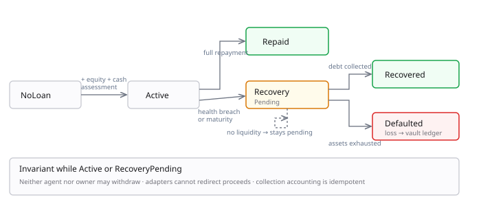

# 02 · Credit Accounts

The foundation. Week one's work. Everything else assumes this exists.

## The attack this closes

An operator spins up several agents, builds cheap repayment histories, borrows the maximum, and abandons them. The protocol records the defaults perfectly. **Lenders still lose.** Reputation alone cannot solve this: the attack is profitable even when identities persist.

The corollary that reorders the whole plan:

> **Lowering a credit limit recovers nothing.** It stops future borrowing. The capital already disbursed is untouched.

## Mechanism

Borrowed funds never reach the agent's wallet.

```text
Lender capital ──► CreditVault ──► CreditAccount ◄── agent equity
                                         │
                                   [ policy gate ]
                                         │
                              approved adapters only
                                         │
                                   strategy venue
```

### Invariants — contract-enforced

1. **Whitelisted adapters only.** Registered adapters, fixed selectors. No arbitrary `call` or `delegatecall`.
2. **No withdrawal while debt is active or recovering.** Binds the **owner**, not only the agent. This is the load-bearing rule and the one the demo shows failing.
3. **Health maintained.** Normal adapter calls that would breach required coverage revert; the dedicated recovery path permits bounded risk reduction below normal thresholds.

   **How, precisely.** `CreditAccount` computes no LTV and no coverage ratio. Those are the engine's, and they arrive as the oracle's permission bit: a risk-increasing call reverts when permission is absent, expired, or bound to a different account state version. So a breach surfaces at the next assessment rather than at the moment of the trade, and the window between them is the monitoring interval.

   That is weaker than "the contract checks coverage", and the difference is worth stating: an agent can trade into a breach and only be stopped on the next cycle. What the contract does guarantee is that it cannot keep doing so. Corrected after review, 14 September.
4. **Proceeds return to the account.** Adapters cannot redirect output.
5. **Close-out ordering.** Principal, then accrued interest, then residual equity to the bound recipient.

Initial funding requires agent equity. **An agent with no equity receives no credit in v0.**

Precedent worth reading first: Gearbox's credit-account model — pools funding restricted accounts with approved execution routes and solvency checks.

## Coverage — one definition

```text
marked_coverage = marked_net_recoverable_value / outstanding_debt
outstanding_debt = principal_outstanding + unpaid_accrued_interest
stressed_coverage_s = stressed_net_recoverable_value_s / debt_with_reserved_interest
```

Two distinct uses, never conflated:

| Measure | Prices used | Purpose |
|---|---|---|
| **Marked maintenance coverage** | Current | Health, recovery eligibility |
| **Stressed origination coverage** | Shocked post-action portfolio | New-draw capacity, with full-term interest reserved |

Closeout costs are **already deducted** from the numerator in both. Origination's debt denominator includes the new principal and reserved full-term interest. Monitoring instead uses existing principal, unpaid accrued interest, and remaining contractual interest; it does not add already collected interest again. An offchain stress scenario is not an executable liquidation price. See [04 · Evidence Contract](04-evidence-contract.md) for the reciprocal LTV ratios and exact threshold comparisons.

## Failure path



| Trigger | Action | Enforced by |
|---|---|---|
| Marked coverage < 1.20 | New borrowing blocked | Engine, at assessment |
| Marked coverage < 1.15 | Warning; no risk-increasing action | Engine, at assessment |
| Marked coverage < 1.10 | Engine withholds permission; the oracle records the withdrawal | Engine, then oracle |
| Permission explicitly withdrawn | Recovery opens immediately | `LoanManager.openRecovery` |
| Maturity passed | Recovery opens immediately; no discretionary grace | `LoanManager.openRecovery` |
| Permission lapsed 12h+ | Recovery opens; silence is a backstop, not a trigger | `recoveryGraceSeconds` |
| Post-unwind shortfall | Loss allocated to vault, recorded against the original binding | `CreditVault.recordLoss` |

> **Corrected 14 September.** The third row used to read "Recovery
> eligible", which is not what the contracts do: **`LoanManager` never
> reads a coverage ratio.** It recovers on maturity, on an explicitly
> withdrawn permission, or after 12 hours of attestor silence. A low
> coverage ratio reaches chain only by causing the engine to withhold
> permission — which is then the second row's trigger, not a separate one.
>
> The distinction matters because it says who can seize an account. A
> ratio in a document is not an on-chain condition, and a reader who
> believed this table would expect liquidation at a threshold the
> contracts cannot observe.

These are **scenario-policy starting values**, to be checked against the actual asset and venue in milestone two (14–17 September). The separate minimum stressed origination coverage is also pinned in policy; passing current marked coverage alone cannot authorize a draw. These thresholds do not guarantee that a fast move cannot jump below solvency.

A dedicated recovery path must be able to reduce risk in an unhealthy account **even when it cannot restore the normal threshold in one step** — otherwise the health check itself prevents liquidation.

## Custody does not guarantee a recovery rate

A liquidation path creates a recovery **route**, not a recovery **rate**.

Account: 5,000 equity + 5,000 borrowed, 10,000 deployed. Illustrative calculations, not tested outcomes — execution cost is the named assumption and separates otherwise identical rows.

| Shock | Gross | Cost | Net | Principal loss | Illustrative LGD |
|---|---|---|---|---|---|
| 40% | 6,000 | 80 | 5,920 | 0 | 0.0% |
| 50% | 5,000 | 60 | 4,940 | 60 | 1.2% |
| 60% | 4,000 | 120 | 3,880 | 1,120 | 22.4% |
| 60% | 4,000 | 60 | 3,940 | 1,060 | 21.2% |
| 75% | 2,500 | 200 | 2,300 | 2,700 | 54.0% |
| 90% | 1,000 | 400 | 600 | 4,400 | 88.0% |

The two 60% rows are the **same shock under different cost assumptions.** Closeout cost creates a principal loss at the 50% shock even before a larger gap is considered. The equity cushion and execution quality affect recovery, but custody establishes no guaranteed recovery floor.

Here `principal_lgd = principal_loss / original_principal`, bounded from 0% to 100% for a positive original principal. Unpaid interest is recorded separately. **Label assumed LGD, illustrative calculations, and measured scenario outcomes distinctly.** Only retained executions may be described as realized results. [07 · Simulation](07-simulation.md) requires measuring the implemented collection path, including near-zero recovery.

## Illustrative worked loss path

5,000 equity, 5,000 borrowed at 12% for ten days, 10,000 deployed. Full-term interest ≈ 16.44, debt ≈ 5,016.44.

A shock at maturity cuts realizable proceeds to 4,000. Venue cost 40, bounded recovery fee 20 → net collection 3,940. Principal loss 1,060; 16.44 interest uncollected; total shortfall ≈ 1,076.44. **Illustrative principal LGD 21.2%.** This is hand-calculated, not a retained execution result.

The agent receives no residual equity. The ledger records principal loss separately from unpaid interest.

**This exceeds the equity cushion and demonstrates that enforced custody cannot eliminate market losses.**
