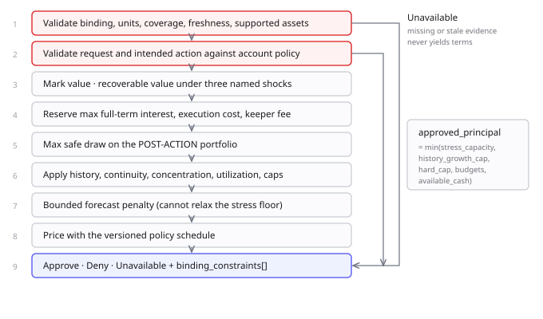

# 03 · Underwriting



## Evaluation order — fixed

1. Validate binding, units, coverage, freshness, supported assets
2. Validate request and intended action against account policy
3. Mark value; compute recoverable values under **three named shocks**
4. Reserve maximum full-term interest, execution cost, bounded keeper fee
5. Compute maximum safe draw on the **post-action** portfolio
6. Apply history, configuration continuity, concentration, utilization, hard caps
7. Apply bounded forecast penalty where enough eligible outcomes exist
8. Price with the versioned policy schedule
9. Approve, deny, or mark unavailable with binding constraints and evidence references

**Step 3 is mandatory in three forms** — price shock, liquidity shock, and combined price + liquidity shock — restoring the original comparison. Volatility scaling supplements these; it never replaces them, and a **declared minimum stress floor** prevents a calm observation window from silently weakening the test. Report all three side by side.

**Step 5's post-action framing is essential.** A draw adds both cash and a debt obligation, and the intended trade changes recoverability. Computing capacity from the pre-draw portfolio is insufficient.

```text
approved_principal = min(stress_capacity, history_growth_cap, account_hard_cap,
                         remaining_strategy_budget, remaining_vault_budget,
                         available_cash)
```

Bounded monotone search, verified against a slow reference implementation.

## The five quantities

Distinct everywhere. The vision conflated them.

```text
facility_limit       what the facility permits in total
requested_principal  what the agent asked for
approved_principal   what this assessment permits now
outstanding_debt     principal + accrued interest currently owed
available_credit     facility_limit - outstanding_debt          (headroom)
```

**`available_credit` is headroom, not drawable cash.** The one-active-loan rule can block a draw while headroom is positive; vault budget can block it too. Never present headroom as immediately borrowable.

## Pricing

A **versioned APR policy schedule**: base rate, bounded history discount, portfolio surcharge, minimum and maximum rate. Frozen with demo fixtures after behavioral testing. **Experimental terms, not empirically estimated fair prices.**

Where an assumed PD is displayed, report it **separately** from the policy APR and run a consistency check:

```text
scenario_expected_loss = PD_over_term × LGD_assumption × exposure_at_default
term_interest          = principal × APR × term_seconds / seconds_per_year
```

All three on the **same horizon**. Price the term, then annualize for display — compounding a 30-day PD to annual overstates low grades and breaks the curve at high ones.

Label funding expense, operating expense, uncollected interest, expected loss, and gross interest separately. **Gross interest minus expected loss is not lender profit** — that needs a probability-weighted cash-flow model.

**Do not make every borrower acceptable by raising APR.** Deny when stress coverage fails, evidence is insufficient, price exceeds policy, or the agent's committed expected benefit does not support the cost.

## Reconciliation examples

Explanatory arithmetic and test-vector candidates — **not calibration.**

| Example | Calculation | Result |
|---|---|---|
| Original rate example | 10,000 × 9.8% × 30/365 | 80.55 gross interest |
| Original PD, zero recovery | 10,000 × 1.7% × 100% | 170.00 expected loss |
| Same PD, 50% LGD | 10,000 × 1.7% × 50% | 85.00 expected loss |
| Spread at requested ceiling | (18.7% − 9.1%) × 14/365 | 0.3682% over 14 days |
| Spread at granted rate | (18.7% − 8.9%) × 14/365 | 0.3759% over 14 days |

The first three show why a recovery assumption matters, and why the original pairing was inconsistent: **9.8% APR earns 80.55 while a 1.7% PD implies 170.00 of expected loss.** The lender loses in expectation.

The last two correct the original's unit error. Both rates are from the vision and both are correct — 9.1% is the ceiling the agent *requests*, 8.9% is what is *granted*. Either way a 14-day trade at 18.7% annualized gross yields an **annualized spread of 9.6–9.8%, which is 0.37–0.38% over the term — about $37 on $10,000** — not a 9.6% period return.

## Interest convention

```text
accrual_end = recovery_started_at if recovery_has_started else now
elapsed     = min(max(accrual_end - originated_at, 0), term_seconds)
interest_accrued = ceil(principal_base_units × apr_bps × elapsed
                        / (10_000 × 365 × 86_400))
interest_due = interest_accrued - interest_already_collected
debt_due     = principal_outstanding + interest_due
```

Simple fixed APR, 365-day year, chain-time seconds, overflow-safe arithmetic. Accrual stops at maturity or recovery entry, whichever comes first; snapshot on entering recovery so partial collections need no new schedule. No late penalty, no compounding. Early full repayment pays accrued interest only.

**An assessment update never reprices an outstanding fixed-rate loan.** Future loans use the new terms.

Reserve maximum full-term interest when sizing capacity. Price from the pre-draw assessment, verify the reserve covers the final APR, re-solve if it does not. Enforce maximum term and borrower-specified maximum APR at draw time.

## Score — derived, not invented

```text
agent_capacity = min(stress_capacity, history_growth_cap, account_hard_cap)
score          = 300 + 600 × (agent_capacity / account_hard_cap)        # 300–900
```

**`agent_capacity` deliberately excludes every lender-side term** — vault budget, strategy budget, available cash. Scoring `approved_principal` would let a borrower-quality number move when nothing about the borrower changed: at a 12,000 cap and 9,000 capacity the score is 750, but if vault cash fell to 4,500 the same agent would score 525. Vault scarcity belongs in `available_credit`.

It is a **facility-relative capacity index, not portable borrower quality** — scaled by *this* facility's hard cap, so it is not comparable across facilities. Label it that way on screen. **It is not a credit rating.** Never show a letter grade: A/AAA implies a calibrated default scale that does not exist.

Always show the binding constraint beside the score. The score alone hides *why* the limit is what it is.

## Factors — measured, not attributed

Re-run the pure engine with each feature set to a **declared policy reference value** — never with evidence removed. Removing positions or valuation triggers the evidence policy, which returns `Unavailable`: the limit is then undefined, not higher, and the comparison is meaningless. **Every counterfactual must be a complete, valid portfolio yielding an executable limit.**

| Factor | Counterfactual reference | Limit | Δ |
|---|---|---|---|
| 37 repayments, exposure-weighted | zero-history baseline | 6,400 | −2,600 |
| Low historical drawdown | policy median drawdown | 7,800 | −1,200 |
| Zero liquidations | policy baseline rate | 8,300 | −700 |
| ETH concentration | diversified reference | 10,100 | +1,100 |
| Leverage increase | policy reference leverage | 9,600 | +600 |

*Illustrative against 9,000 agent capacity and a 12,000 hard cap. Every reference value is versioned policy, published with the panel.*

**Deltas do not sum to the score.** `approved_principal` is a `min()` over competing constraints, so effects are non-additive — a factor that is not binding contributes nothing until it becomes binding. Present each row as *"what this factor is worth right now"*, never as a decomposition. Genuine missing-data behavior is tested separately.

This is stronger than a weighted panel: each value is a measured consequence a judge can reproduce with `credence risk assess`.

## Behavioral underwriting must be visibly causal

`min()` creates a product risk that outranks every integration question. If stress capacity is 3,000 while history cap improves from 4,000 to 6,000, capacity stays 3,000 — **the history improved and the product delivered nothing.** Often correct; fatal if it is the only outcome demonstrated, because then agent behavior is decorative and this is a competent collateralized lender rather than Credence.

### Controlled ablation — release requirement

| Run | Held constant | Varied | Must show |
|---|---|---|---|
| A→B | Equity, positions, market, strategy, liquidity | Eligible repayment history only | Exact change in limit and APR attributable to history |
| A→C | Same, plus history | Forecast evidence only | Exact change attributable to forecast quality |
| A→D | Same | Portfolio risk raised | Hard constraints override both; which binds, by how much |

Every run reports the **binding constraint by name**. **Fixtures must be calibrated so history and forecast bind in A→B and A→C** — if stress capacity clamps every scenario, the demo cannot show behavior mattering, and the fixtures are wrong.

### Three sequential loans — release requirement

The ablation proves history *would* change terms. It does not show credit **compounding**, which is the original thesis. The performer completes at least three sequential loans in one run, unchanged policy and model hash, facility recomputed after each:

| Loan | History at request | Limit | APR | Binding constraint |
|---|---|---|---|---|
| 1 | none | base | base | history cap |
| 2 | loan 1 repaid | higher | lower | history cap |
| 3 | loans 1–2 repaid | higher still | lower still | **stress capacity** |

The constraint switching by loan 3 is the `min()` story told honestly: history opens the facility until portfolio risk becomes the limit. Cheap in virtual time. **Sequential, not concurrent** — one active loan per account is unchanged.

## Continuous underwriting

The original's climax is a shock changing risk **while a loan is open and the agent requested nothing**. Origination checks, recovery thresholds, and post-repayment reassessment do not require that behavior — a system could pass the whole demo script without it.

**Release requirement:**

> While a loan is active and the agent submits no new request, a market observation changes. The Go scheduler detects it, triggers reassessment, Rust produces a new assessment, and the updated risk state reaches the chain within a declared interval.

| Property | Specification |
|---|---|
| Owner | Go scheduler — the only component with a clock |
| Trigger | Price move beyond policy threshold, or evidence staleness |
| Interval | Declared per deployment; measured in the latency report |
| Effect | Changes **future borrowing permission** |
| Explicitly not | Repricing the outstanding loan, or forcing recovery on its own |
| Failure | Scheduler offline → evidence stales → risk-increasing actions blocked, repayment open. **Fail-closed, never fail-silent.** |

**Changing what an agent may borrow next is not the same as recovering what it already owes.** Continuous underwriting governs permission; recovery governs exposure.

## Presentation discipline

Lead with eligibility, limit, APR, stressed coverage, and binding constraints. Display sample size and data origin before any aggregate statistic. Do not invent universal grades.
